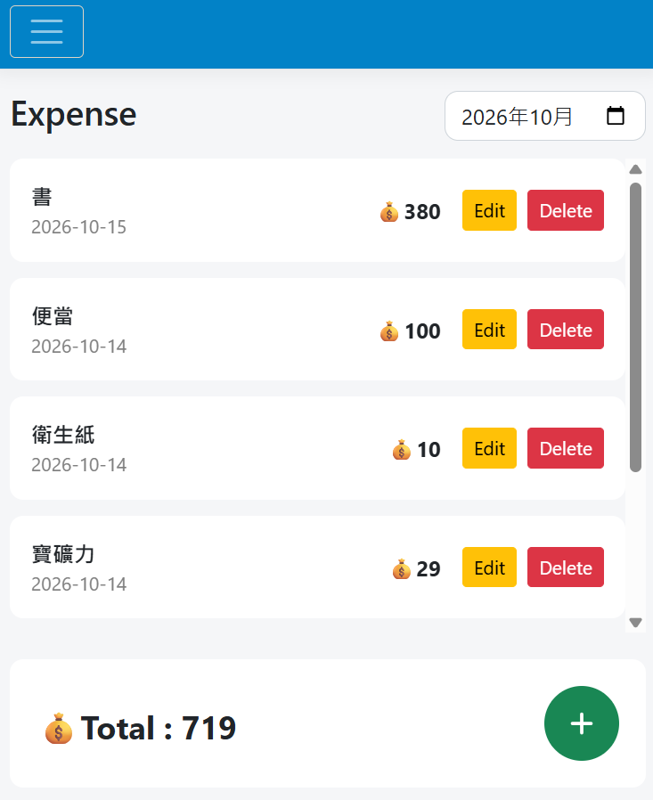
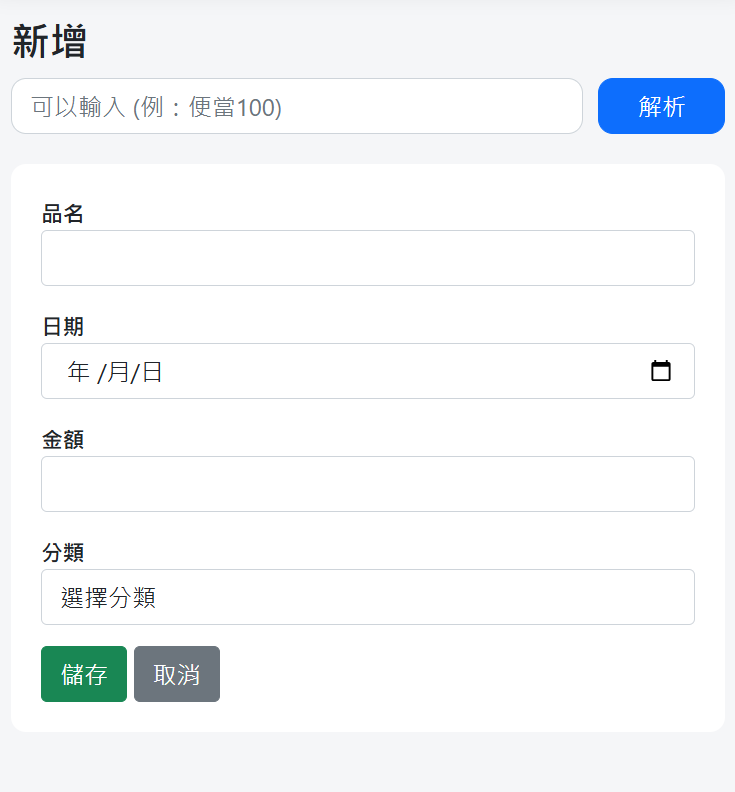

# Expense-PocketLog

使用 ASP.NET Core MVC 開發，把簡單、明確的 UI 與 LLM API 支出解析功能結合，讓日常開支記錄變得輕鬆。

## Demo
👉 [Live Demo][https://expense-0uft.onrender.com]

---

## 螢幕截圖



## 部署事項

專案部署在 Render 免費方案，由於平台限制，會有以下狀況：
*   **自動休眠**：超過 **15 分鐘**沒收到任何請求會自動進入「休眠」。
*   **冷啟動**：休眠後打開，可能需要等個 **30 - 60 秒**。

---

## 功能
- 🔐 使用者註冊 / 登入
- 🤖 使用 Gemini API 解析自然語言記帳
- ✏️ 編輯記帳紀錄
- 🗑️ 刪除記帳紀錄
- 📊 Expense 頁面查看記帳紀錄
- 📅 月份選擇器查看過往記帳紀錄
- 📆 計算當月記帳總金額

---

## 技術與框架
- ASP.NET Core MVC (.NET 8)
- Entity Framework Core
- PostgreSQL (Neon)
- ASP.NET Identity
- Razor View
- Docker
- Google Gemini API
- Render（部署）

---

## 專案結構

```
expense
├── wwwroot
├── Controllers
├── Data
├── Migrations
├── Models
├── Views
├── Services
├── Dockerfile
└── Program.cs
```

---

## 筆記

透過此專案我學到：
- ASP.NET Core MVC 
- Entity Framework Core Migration
- ASP.NET Identity 
- PostgreSQL / Neon 雲端資料庫整合
- Docker 容器化
- Render 雲端部署
- Google Gemini API 自然語言解析
